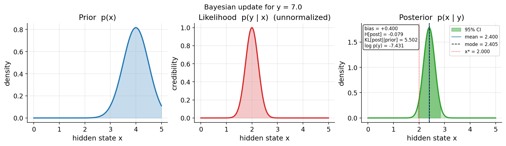
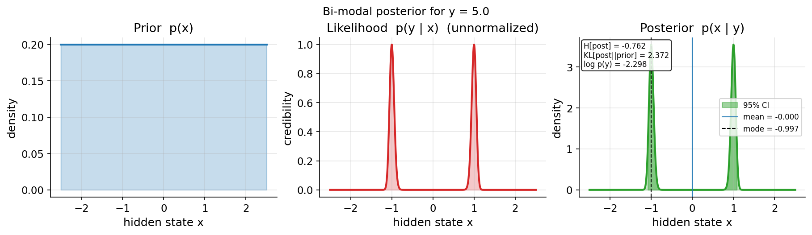

# Artifacts and Evidence {#sec:artifacts_evidence}

## Evidence Inventory

The canonical source-surfaces table lives in
[`S01_source_surface.md`](S01_source_surface.md); each surface there is a
source directory to inspect before turning prose into claims.

## Registered Figures

Every figure cited here is registered in `output/figures/figure_registry.json`
against the file its orchestrator writes, and the renderer refuses to build when
the file is absent or the registry entry is unused.

::: {#fig:bayes_three_panel}
{width=85%}
:::

The panel series in @fig:bayes_three_panel comes from `chapters/chapter_01/03_bayes_intuition.py`, which builds a `LinearGaussianModel`, runs `GridBayesianInference` on a 500-point grid, and plots prior, likelihood, and posterior with the library's `plot_prior_likelihood_posterior` helper. The same script writes `03_bayes_overlay.png` and `03_bayes_evidence.png` plus the matching NPZ and JSON sidecars.

::: {#fig:inverse_posterior}
{width=85%}
:::

@fig:inverse_posterior is the inverse-problem counterpart, produced by `chapters/chapter_01/04_inverse_problem.py` with the generator `g(x) = 3 + 2x^2` and a uniform prior. Both signs of `x` explain the same observation, so the posterior keeps two modes; the orchestrator reports both modes and the chapter's overlay figure annotates them.

## Current Evidence Status

The repository's reproducible surface is larger than this draft cites. The figures above are a deliberate sample: each has a producer under `chapters/`, a recorded expectation in `output/figures/chapter_01/README.md`, and a rendered-artifact check (`scripts/validate_rendered_figures.py`). Additional figures should be added here only after their producer writes a stable file and the registry entry records its caption and alternative text.

## Claim Discipline

A claim is manuscript-ready only when it has one of the following support types:

- A passing test or validator command.
- A generated output with a deterministic producer.
- A source ledger, manifest, or configuration file.
- A resolved entry in `references.bib` for external literature.
