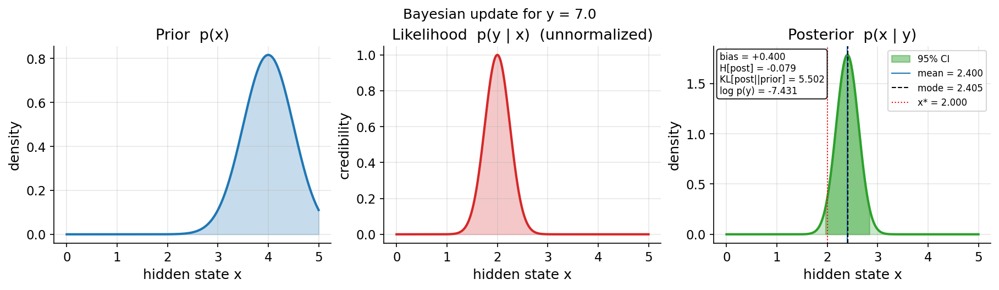

# Manuscript Syntax - fundamentals

This manuscript follows the shared template conventions for section structure,
Pandoc citations, and `pandoc-crossref` labels. It is rendered by
`scripts/render_manuscript.py`, which validates every surface below before
Pandoc runs. The `manuscript-check` arm validates without Pandoc; the
`manuscript` arm validates and renders.

Rendering requires both `pandoc` and `pandoc-crossref`; enabled PDF output
also requires `xelatex`. Missing tools return exit code 3 before rendering
or replacing an existing render receipt. Every rendering command includes
the cross-reference filter.

`--check` validates manuscript sources without invoking these tools. A
successful check is not evidence that section/figure references rendered
correctly in HTML or PDF.

## Section Labels

| File | H1 | Label |
|---|---|---|
| `00_abstract.md` | Abstract | `{#sec:abstract}` |
| `01_introduction.md` | Introduction | `{#sec:introduction}` |
| `02_system_context.md` | System Context | `{#sec:system_context}` |
| `03_methods.md` | Methods | `{#sec:methods}` |
| `04_artifacts_and_evidence.md` | Artifacts and Evidence | `{#sec:artifacts_evidence}` |
| `05_reproducibility.md` | Reproducibility | `{#sec:reproducibility}` |
| `06_limitations_and_next_steps.md` | Limitations and Next Steps | `{#sec:limitations_next_steps}` |
| `S01_source_surface.md` | Supplemental Source Surface | `{#sec:source_surface}` |
| `98_symbols_glossary.md` | Symbols and Glossary | `{#sec:symbols_glossary}` |
| `99_references.md` | References | `{#sec:references}` |

Admitted order is main sections (`00_`–`89_`), then supplements (`S01_`), then
back matter (`90_`–`99_`). Every section file must contain exactly one H1 and
that H1 must end with its `{#sec:...}` label; labels must be unique. Reference a
section with `[@sec:label]` or `@sec:label`, never a filename link.

## Citations

Use Pandoc citation syntax only, for example `[@real_key]`. Every key must exist
in `references.bib` before it appears in prose, because
`bibliography.fail_on_missing` is `true`. Keys in the `sec:`, `fig:`, `tbl:`,
`eq:`, and formalism namespaces belong to `pandoc-crossref` and are not
bibliography lookups.

## Figures

Generated figures live under `../output/figures/` and are registered in
`output/figures/figure_registry.json`. A section names the label and the image;
the registry supplies the alternative text and the caption, so neither is a
second hand-maintained copy:

```markdown
::: {#fig:example}
{width=85%}
:::

Cross-reference it as @fig:example.
```

Rules enforced by the renderer:

1. Every image sits inside a `::: {#fig:label}` block, and the block holds only
   that image. Author the brackets empty.
2. The block's label must be a key in `figure_registry.json`, and the path must
   equal `../output/figures/<filename>` for that entry.
3. Every registry entry must name a `label`, `filename`, `generated_by`,
   `caption`, and `alt_text`; the file must exist, the producer must exist, and
   `alt_text` must describe the figure rather than repeat the caption.
4. The registry may not record a figure the prose never cites.

## Manuscript Variables

Every dynamic value is a `{{TOKEN}}` declared in `variables.yaml`:

```yaml
schema: manuscript-variables/v1
variables:
  CHAPTER_COUNT:
    value: "14"
    source: "chapters/chapter_NN directories"
```

The renderer recomputes each value from tracked state and fails when the
declaration has drifted, when prose uses an undeclared token, or when a declared
token goes unused. To add a variable: add its producer to
`compute_variables()` in `scripts/render_manuscript.py`, declare it here, use it
in prose, then run `./gate.sh manuscript-check`.

## Preamble

`preamble.md` holds the project's LaTeX preamble in a fenced `latex` block. The
renderer passes every such block to Pandoc as `--include-in-header` when it
renders the PDF.

## Formats

`config.yaml` `render.formats` selects what is produced. The renderer supports
`html` and `pdf`; enabling any other format is a configuration error rather than
a silent skip. PDF rendering needs `pandoc` and `xelatex` on `PATH`, and the
renderer names whichever tool is missing instead of producing partial output.

## Render

```bash
./gate.sh manuscript-check   # validate only
./gate.sh manuscript         # validate and render
```

Outputs and the render receipt are written under `docs/_build/manuscript/`,
which is gitignored.
